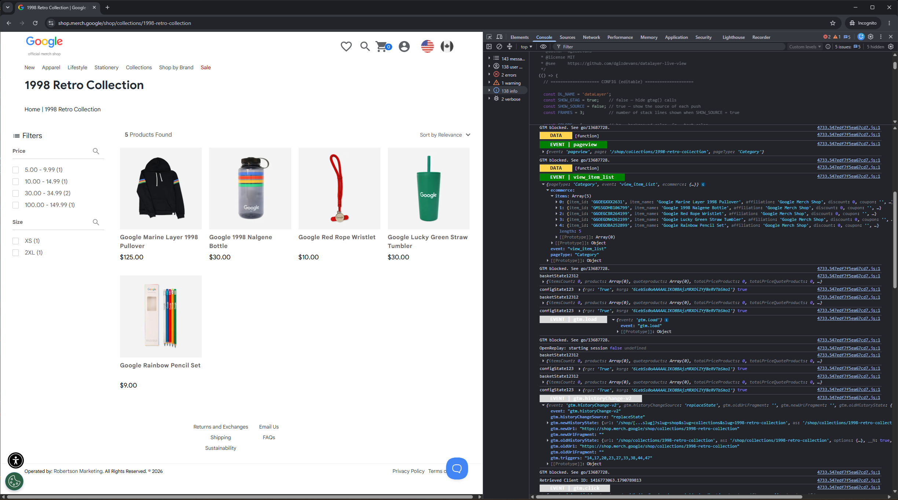

# dataLayer Live View

A lightweight DevTools script for real-time monitoring and debugging of `dataLayer` pushes.

## Features

- Logs every `dataLayer.push` to the console, color-coded by type
- Distinguishes events, GTM internal events, `gtag()` commands and data-only pushes
- Shows entries pushed before the script was started
- Snapshots each push at the moment it happens — later mutations of the object don't affect the log
- Optional: show the source (call stack) of each push
- Optional: hide `gtag()` calls
- Detects container and tag IDs exposed via `google_tag_manager` (`GTM-…`, `G-…`, `AW-…`, `DC-…`)
- No browser extension, no dependencies

## Usage

### Option 1 — Console

1. Open DevTools → **Console**.
2. Paste the contents of `datalayer-live-view.js` and press **Enter**.

Run it again after each page reload.

### Option 2 — Live Expression (Chrome, Edge)

1. In **Console**, click the eye icon (**Create live expression**).
2. Paste the contents of `datalayer-live-view.js`.

The script re-attaches automatically after each page reload.

Enable **Preserve log** in Console settings to keep logs across page reloads.

## Configuration

All settings are in the `CONFIG` block at the top of the script.

| Setting           | Default       | Description                                                                    |
|-------------------|---------------|--------------------------------------------------------------------------------|
| `DL_NAME`         | `'dataLayer'` | Name of the data layer object                                                  |
| `SHOW_GTAG`       | `true`        | `false` hides `gtag()` calls                                                   |
| `SHOW_SOURCE`     | `false`       | `true` shows the call stack of each push                                       |
| `FRAMES`          | `3`           | Number of stack lines shown when `SHOW_SOURCE` is on                           |
| `PAUSE_ON_UNLOAD` | `false`       | `true` pauses in the debugger before the page unloads (last resort, see below) |
| `COLORS`          | see script    | Background (`bg`) and text (`fg`) color per type                               |

### PAUSE_ON_UNLOAD

A last-resort option, not convenient for regular use. When `PAUSE_ON_UNLOAD = true`, the script runs `debugger;` in a `beforeunload` handler, so DevTools pauses before the page navigates away. That gives you time to inspect the Console and `dataLayer` before the next page loads. The pause does not preserve anything by itself, and it only happens while DevTools is open.

To turn it on or off, change the flag and run the script again. The change applies without a page reload. The pause also works on pages without `dataLayer`.

Limitations:

- It fires on page reload as well, not only on link navigation (`beforeunload` fires in both cases).
- On every pause DevTools switches to the **Sources** panel. Switch back to **Console** manually.
- It isn't obvious from **Sources** that the script caused the pause: it highlights the whole line `window[UNLOAD_KEY] = PAUSE_ON_UNLOAD ? () => { debugger; } : null;`, and the call stack shows only `window.<computed>`.
- The flag can't be changed while the page is paused: JavaScript is stopped, so the Live Expression doesn't re-evaluate until you resume.

## Output

| Label                      | Default color | Meaning                                                  |
|----------------------------|---------------|----------------------------------------------------------|
| `EVENT \| <name>`          | green         | Push with an `event` key (except `gtm.*`)                |
| `EVENT \| gtm.*`           | light grey    | GTM internal event (`gtm.js`, `gtm.dom`, `gtm.load`, …)  |
| `GTAG <command> \| <arg>`  | grey          | `gtag()` call (`config`, `consent`, `set`, `event`, …)   |
| `DATA`                     | yellow        | Push without an `event` key, e.g. `{ ecommerce: null }`  |

**`dataLayer: N entries before interception`** — collapsed group with everything pushed before the script started.

**Return value** — container and tag IDs exposed via `google_tag_manager` (`GTM-…`, `G-…`, `AW-…`, `DC-…`).

## Screenshot

## Notes

- The `//# sourceURL=datalayer-live-view.js` directive names the script; when `SHOW_SOURCE` is on, the filter in `getSource()` excludes the script's own stack frames by that name — keep it.
- Entries pushed before interception have no source information.